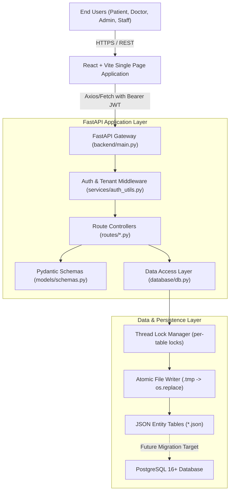

# 03: System Architecture & Data Flow

## 1. High-Level Architectural Diagram

## 2. Multi-Tenancy Segregation Mechanism
- Every record created within a hospital or clinic context stores an immutable `organization_id` (e.g. `hosp-001`).
- The backend checks `current_user['organization_id']` against the requested resource.
- Cross-tenant data inspection is rejected with HTTP 403 Forbidden.

## 3. Storage Layer & Atomic File Writing
In `backend/database/db.py`:
- Each table (`hospitals.json`, `appointments.json`, etc.) is guarded by a dedicated `threading.Lock`.
- Data is written to `table.tmp` and then renamed via `os.replace` to ensure zero file corruption.
