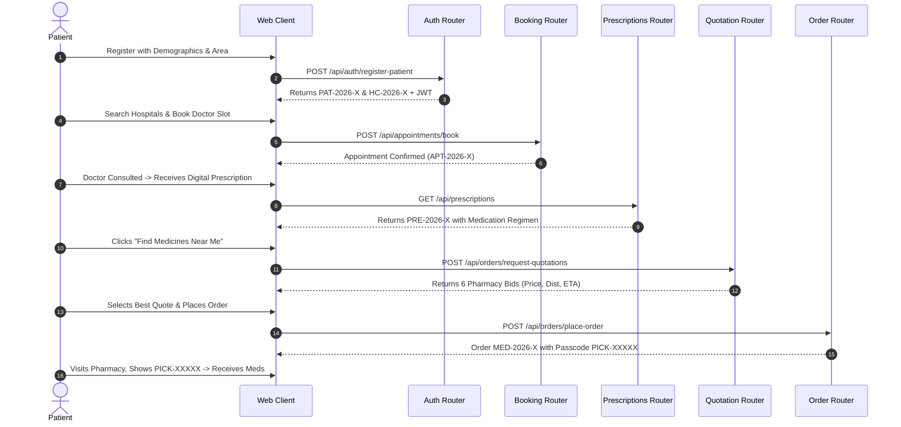

# 08: Patient Workflow & Lifecycle

## 1. Overview
The patient represents the primary consumer persona. Through a single account, the patient interacts with multiple hospitals, polyclinics, specialists, and pharmacies.

## 2. End-to-End Patient Journey

## 3. UI Views for Patient
- `/dashboard/patient`: Telemetry, Quick Action Bar, Overview tab.
- `/dashboard/patient/appointments`: Schedule & statuses.
- `/dashboard/patient/prescriptions`: Digital prescriptions and simulated OCR upload modal.
- `/dashboard/patient/records`: Diagnostic lab reports and Consent sharing modal.
- `/dashboard/patient/orders`: Medicine orders and counter pickup passcodes.
